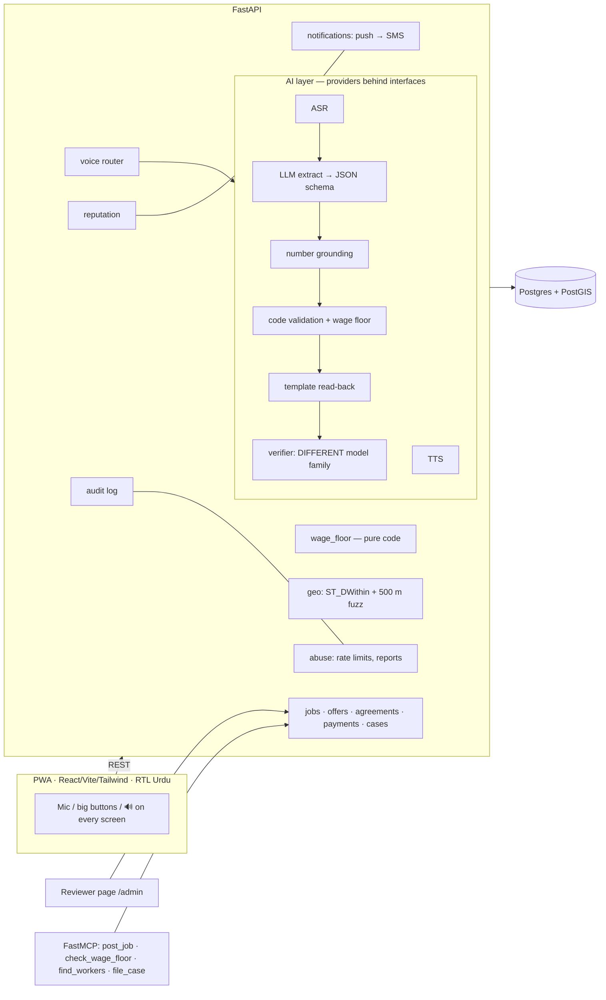

# Dihari (دیہاڑی)

Map-first Urdu and English job marketplace for daily-wage labour. Hirers (households, thekedars, businesses) post a job **by speaking**; nearby workers hear it read aloud, accept at the offered rate or counter **upward only**; the app keeps a shared record of what was promised and whether it was paid. Pakistan is market #1 — **every country-specific fact is configuration** (`config/`, `locales/`), not code.

> The home screen requests location and supports manual pins and area search. Workers can book a remaining spot at the posted rate or send a higher counter. Signed-in screens refresh while open. Street tiles and landmark lookup use external services. Demo OTPs appear on screen. See [provider setup](docs/PROVIDERS.md) for optional SMS and background alerts.

## Quick start

```bash
# Backend (SQLite, mocks, seeded demo data)
cd backend && python3 -m venv .venv && .venv/bin/pip install -e . pytest
cp ../.env.example .env
.venv/bin/python scripts/seed.py            # Islamabad/Rawalpindi demo world
.venv/bin/uvicorn app.main:app --reload     # http://localhost:8000/docs

# Frontend (proxies /api → :8000)
cd frontend && npm install && npm run dev   # http://localhost:5173

# Everything with Postgres + PostGIS
docker compose up --build                   # web :8080, api :8000, reviewer page :8080/admin
```

Demo logins (OTP is shown on screen in `DEV_MODE` with the stub SMS): hirer `03001000000`, worker `03002000000`. Reviewer page token: `demo-reviewer-token`. Walk-through: [DEMO.md](DEMO.md).

Tests: `cd backend && .venv/bin/python -m pytest -q` (offline, 63 tests) · `cd frontend && npm test`.
Simulation: `python -m sim.simulate` · Adversarial set: `python -m adversarial.run`.

## Architecture



**Rule of the design:** code checks are authoritative. The LLM extracts; code grounds every number against the transcript, validates, and enforces the wage floor. The verifier can only *add* a block, never remove one. The AI never decides a dispute — rules propose follow-ups, a **named human** approves or rejects, and the audit log records who.

### Configuration, not code
| Thing | Where |
|---|---|
| currency, phone format, regions, trades, places, holidays, ASR/TTS preferences | `config/countries/<cc>.json` |
| minimum wage, max hours, payment delay, `verified` flag, source URL, effective date | `config/wage_rules/<cc>.json` (versioned) |
| every string, number words, yes/no words | `locales/<lang>.json` (shared by backend + PWA) |
A test adds a dummy country `ZZ` + dummy locale `zz` and runs the full voice pipeline with **zero code changes** (`tests/test_expandability.py`), and another test greps the app code for hard-coded country names/currency/dial codes.

### Privacy rules enforced in code
Exact job location is hidden (deterministic 150–500 m fuzz) until a worker is assigned · hirers see workers by first name only · cases shown to a hirer never include the worker's name or phone · agreements are immutable (ORM blocks update/delete) and hash-stamped · every state change is in the audit log.

## SDG 8 mapping (Decent Work and Economic Growth)
- **8.5** full and productive employment and decent work, equal pay for work of equal value → wage floor on every job; upward-only counters; itemised deductions required.
- **8.8** protect labour rights → hours limit, payment-day check-ins, unpaid cases reviewed by a human, hirer reputation visible to workers.
- **8.3** formalisation of small enterprises/work → a shared, immutable record of agreed terms between informal parties.
- Inclusion by design: voice-first Urdu UI for low-literacy users, works on cheap phones and slow 3G (≈66 kB gzip JS, PWA offline shell, retries, optimistic UI).

## Limitations (please read)
- **It does not create jobs.** It only improves how existing demand is matched. The simulation holds demand constant on purpose.
- **Payment status is self-reported.** No money moves through Dihari; "paid / not paid" is each side's claim. Hirer reputation is a rate of *worker reports* and can be gamed or biased. A hirer marking a worker absent affects that worker's score (no appeal flow yet).
- **Wage rules are NOT legal advice and ship as unverified placeholders** (`min_daily_wage: 1000`, `verified: false`). They must be replaced from the official provincial notification before any real use; the UI warns while a rule is unverified.
- **The simulation shows a mechanism, not real-world results.** Its behavioural assumptions are invented and printed at the top of every report; different assumptions can change the ranking (the default run even shows Dihari filling fewer slots, because floor-blocked hirers abandon jobs).
- **The adversarial evaluation is not a quality claim.** Posts are template-generated and the offline mock extractor was written alongside them; perfect scores are expected. The "LLM-only baseline" is a naive stand-in until a real LLM is configured.
- **Not yet verified end to end:** real ASR/TTS/LLM quality (nothing connected); the PostGIS code path (`ST_DWithin` SQL is compile-checked in tests, but the Postgres container was not run in this environment — Docker daemon was unavailable); on-device Urdu `speechSynthesis` voice availability varies by Android phone; web-push delivery (interface only).
- OTP rate limiting and the abuse limiter are in-process (single instance); use Redis behind the same interface to scale. The MCP server has no end-user auth — operator use only.
- Screens use browser `SpeechRecognition` / `speechSynthesis` when no server provider is configured; these need Chrome on Android and an internet connection for recognition.
